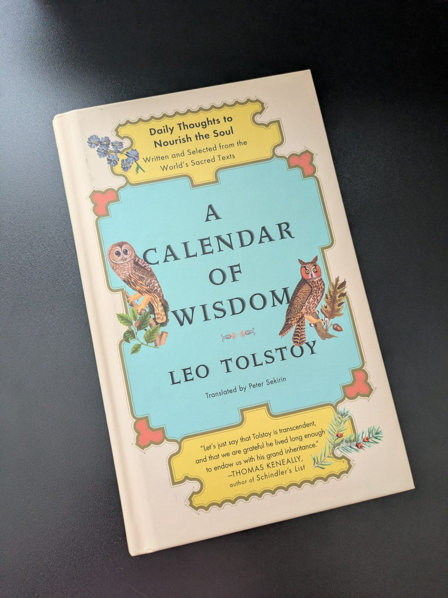

Some days we just need a gentle reminder that we’re stronger and more capable than we think. This little corner of my blog is where I gather the words that lift me when I need the most encouragement - quotes, reflections, and words of wisdom - the little sparks that help me pause, shift perspective, and rediscover my own strength.

Whether you’re reaching for big dreams, moving through challenges, or simply seeking a spark of encouragement in your day, I hope you’ll find something here that resonates. Sometimes the right words at the right time are all it takes to remind us of how resilient and capable we truly are.

**Come back anytime - this collection is always growing, just like we all are!**

------------------------------------------------------------------------

*The merit of a person is not in the knowledge they possess, but in the effort they made to achieve it.* - (modified version) Gotthold Ephraim Lessing

------------------------------------------------------------------------

*Success is built in rooms no one would photograph. The people who change things aren't at the parties, they're home on Friday night, obsessed with problems everyone else finds tedious. Their social media doesn’t look all that extraordinary. Their daily life is not extraordinary. Just the same unsexy routine, day after day. They aren't doing anything glamorous. They're just consistently making steady incremental progress over a long period of time. Success makes noise. Building doesn't. That's the paradox: **Exceptional looks boring until suddenly it isn't**.*

------------------------------------------------------------------------

*Everyone knows what works. Few persist when the novelty fades and it is not exciting anymore.*

------------------------------------------------------------------------

*Work smarter, not harder is often framed as the opposite of hard work, but working smart is itself a derivative of hard work. You have to work hard just to figure out what working smart means. When you start something new, you can’t work smart because you don’t yet know what smart looks like. You have to work hard first, identify the pattern that makes smart possible. It’s like a chess master spotting the best move instantly; it looks like working smart, but it’s built on thousands of hours of working hard to earn that intuition. **Smarter approaches aren’t universal shortcuts, they’re contextual insights uncovered through deep, sustained effort.***

------------------------------------------------------------------------

*Your heroes are your blueprints. Study what makes them exceptional, not to become them but to become who you're capable of being. The point isn't to be a second-rate version of your hero, it's to be a first-rate version of yourself with upgraded tools. Learn their system. Keep your soul.*

------------------------------------------------------------------------

*Nothing is permanent. Some things are just renewed faster than they decay. We want the naturally perfect relationship, but the ones that endure are renewed each morning. Here's the paradox: fragility plus daily care outlasts strength plus neglect. The cast-iron pan seasoned daily outlives the new nonstick. The handwritten menu, which changes daily, outlasts the laminated one. You can only optimize so much, but you can care forever. Efficiency has limits, devotion doesn't.*

------------------------------------------------------------------------

*The meaning of life is to find your gift. The purpose of life is to give it away. - Pablo Picasso*

------------------------------------------------------------------------

*Borrowed wisdom breaks under pressure because you haven't earned it. You're trusting someone else's compression without knowing what created it. Earned wisdom, on the other hand, holds up because it's rooted in your actual experience. You know when it works, why it works, when to ignore it and when to bend it because you created the compression.*

------------------------------------------------------------------------

**References**

Leo Tolstoy: A Calendar of Wisdom. Link to [calendar](https://calofwisdom.com).

Shane Parrish’s [collection](https://fs.blog/blog/) of tiny thoughts, insights, and articles.

