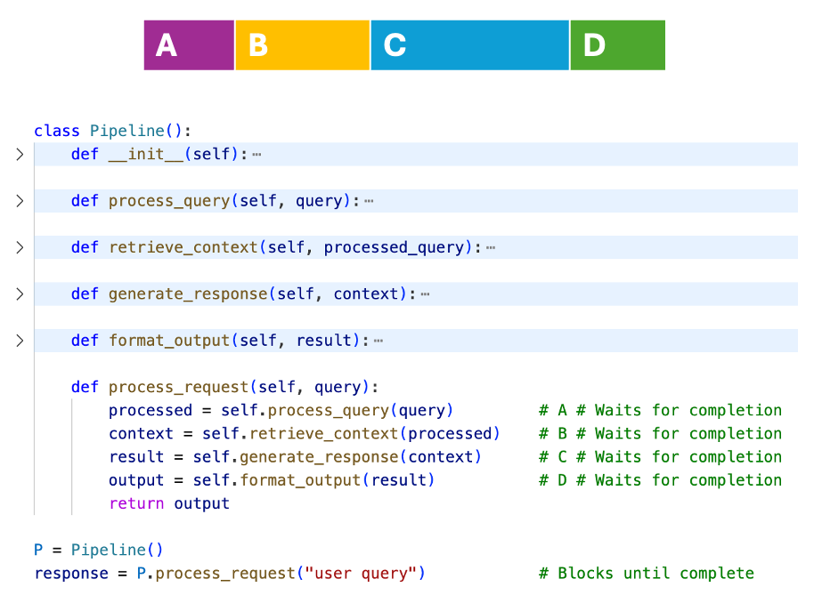
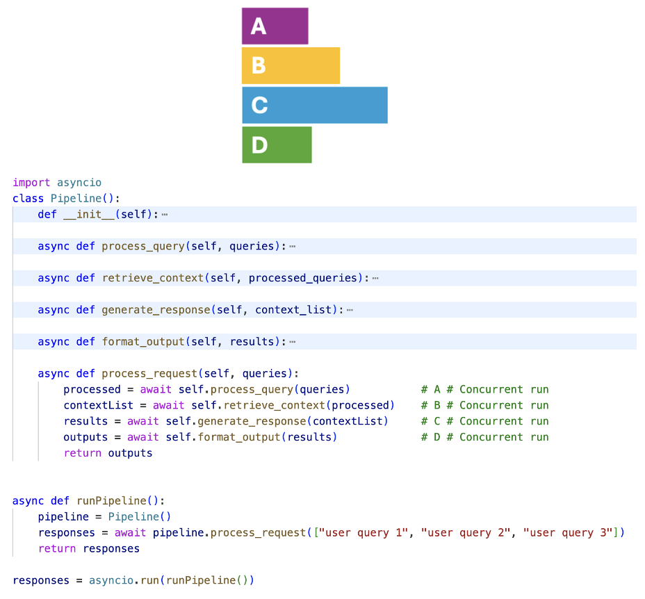
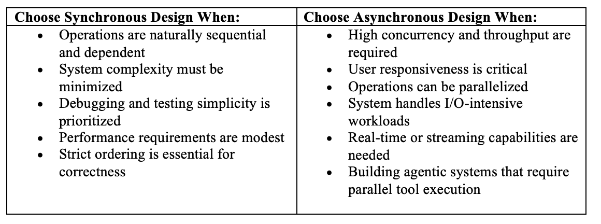
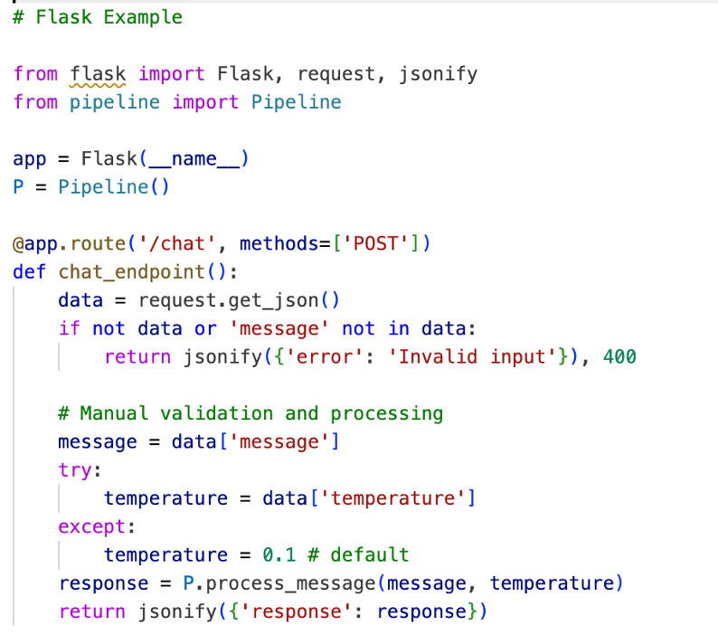
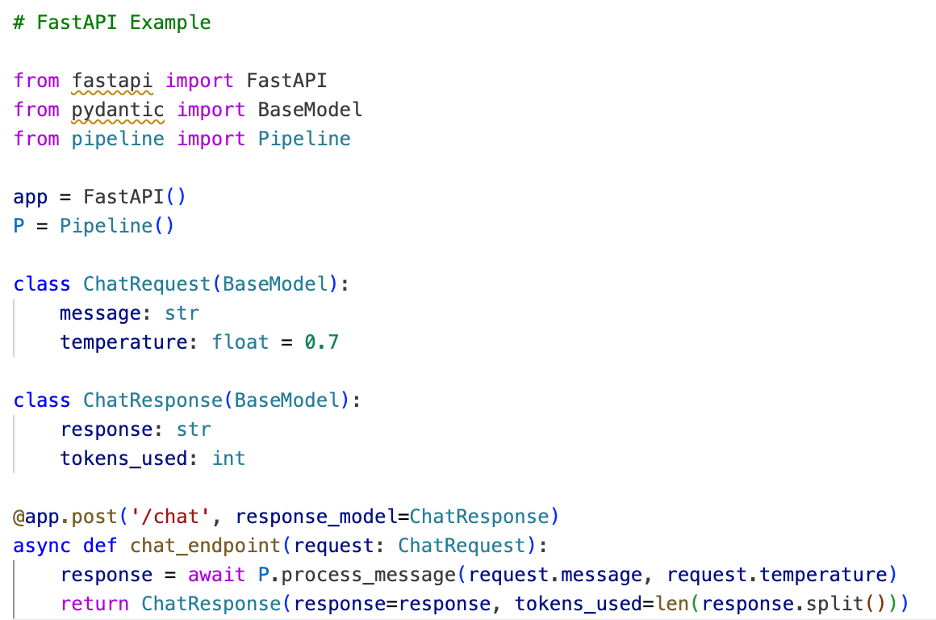
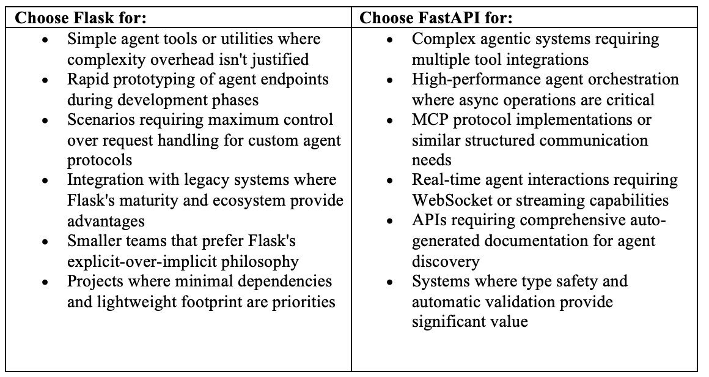

As AI systems evolve from simple model inference to complex agentic workflows, the architectural decisions we make determine whether our applications will scale gracefully or buckle under real-world demands.

The landscape of AI development has shifted. What worked for traditional web applications often falls short when dealing with LLM orchestration, multi-step reasoning chains, and the unpredictable latency patterns that characterize modern AI workloads.

This guide focuses on two fundamental concepts that form the backbone of robust AI systems today.

- **Synchronous vs Asynchronous system design:** Examine how this choice impacts everything from user experience to resource utilization in AI-driven applications
- **API design patterns:** Understand the evolution of API design patterns, from the foundational principles of REST through the practical implementations in Flask, to the async-native capabilities of FastAPI

Whether we’re building AI-powered applications or refactoring existing systems to handle more sophisticated workloads, these concepts will provide the foundation for making informed architectural decisions.

Let's dive in.

## Synchronous vs Asynchronous System Design

System design architecture and programming paradigms fundamentally shape how application components interact and process operations. Two primary paradigms, synchronous and asynchronous, represent different approaches to managing execution flow, each with distinct trade-offs that have become increasingly important as systems grow more complex and distributed.

**Synchronous systems** operate in a blocking, sequential manner where each operation must complete before the next begins. The caller waits for a response before proceeding, creating predictable, linear execution flow. This approach simplifies debugging and ensures strict ordering but can create bottlenecks when slow operations block entire system threads.

In this synchronous system, each step in a process must finish before the next begins. In the Pipeline class example, the methods ***process_query***, ***retrieve_context***, ***generate_response***, and ***format_output*** are executed sequentially, with each step (A–D) blocking execution until it completes. This ensures predictable order but can be slower due to waiting for each task to finish before moving on.

**Asynchronous systems** allow operations to run concurrently without blocking. Callers initiate operations and continue executing other tasks while waiting for completion signals through callbacks, promises, or events. This enables higher throughput and better resource utilization but introduces complexity in state management and error handling.

To build an asynchronous system we will require [asyncio](https://docs.python.org/3/library/asyncio.html). *asyncio* is a library that lets us run tasks at the same time using async/await syntax. It acts like a foundation for python based frameworks to provide high-performance network and web-servers, database connection libraries, distributed task queues, etc. It works best when the code spends a lot of time waiting on things like files, networks, APIs or running models/LLMs.

In this asynchronous system, multiple tasks run concurrently instead of waiting for each other to finish. In the provided Pipeline class example, the methods ***process_query***, ***retrieve_context***, ***generate_response***, and ***format_output*** (labeled A–D) execute asynchronously, allowing for faster overall processing by not blocking each step, thus improving efficiency and responsiveness.

### Why is this choice important to make?

The choice between synchronous and asynchronous design fundamentally impacts system performance, scalability, and user experience. Modern applications require responsive interfaces that can handle multiple concurrent operations—from multiple LLM/API calls to database queries to real-time updates—without freezing or degrading performance.

In **Model Context Protocol (MCP)** implementations, this architectural choice significantly impacts performance and scalability. Synchronous MCP operations ensure strict ordering of context updates and tool executions, crucial for maintaining conversation coherence. However, this creates latency when processing large context windows or executing complex tools.

Asynchronous MCP designs enable parallel processing of multiple context chunks, concurrent tool executions, and non-blocking streaming responses. This proves particularly valuable for real-time applications where users expect immediate feedback while systems process background operations like document retrieval or LLM calls.

**Agentic systems** benefit tremendously from asynchronous architectures due to their multi-step reasoning and tool-use patterns. Synchronous agents must complete each reasoning step sequentially, leading to poor user experience during complex tasks. Asynchronous agents can initiate multiple parallel operations, stream intermediate results, and provide progress updates while continuing background processing.

### When to choose synchronous vs asynchronous system design?

The modern trend heavily favors asynchronous architectures, particularly in AI applications where users expect responsive, real-time interactions even as complex background processing occurs. However, the added complexity requires careful consideration of error handling, state management, and system monitoring to ensure reliable operation.

## API Design Patterns: REST → Flask → FastAPI

API design fundamentally shapes how applications communicate with each other and with users. At its core, API design involves creating interfaces that are intuitive, reliable, and efficient. Modern API design typically follows three main paradigms: REST (Representational State Transfer), GraphQL for flexible data querying, and RPC (Remote Procedure Call) patterns. Each paradigm offers different approaches to structuring endpoints, handling data, and managing client-server interactions.

The importance of thoughtful API design cannot be overstated in today's interconnected software and AI application ecosystem. Well-designed APIs reduce development friction, improve maintainability, and enable scalable integrations. They serve as contracts between different parts of a system, making them critical for everything from microservices architectures to third-party integrations.

The journey of web API development reflects the broader evolution of web technologies and developer needs. **REST APIs** established foundational principles using HTTP methods (GET, POST, PUT, DELETE) with resource-based URLs. While REST provided structure and standardization, implementing REST APIs required extensive boilerplate code, manual request parsing, and careful attention to HTTP protocol details.

**Flask** emerged as a game-changer in the Python ecosystem, introducing a minimalist, WSGI-based approach that abstracted away much of the HTTP complexity. As a micro-framework, Flask provides essential routing and request handling while maintaining the philosophy of leaving most architectural decisions to developers. With Flask, you manually handle request parsing, validation, and response serialization, but within a much more manageable framework structure.

As we can see from this flask example, routing and request handling is performed with decorators, and input validation is done manually within the function. The endpoint receives JSON, explicitly checks for the message field, sets a default temperature if missing, and then calls a processing pipeline before returning a JSON response.

**FastAPI** represents the latest evolution, built on ASGI (Asynchronous Server Gateway Interface) with a focus on modern Python features. It leverages Python type hints and Pydantic models for automatic request/response validation, generates OpenAPI schemas automatically, and provides built-in async support. This framework embodies the principle of convention over configuration while maintaining the flexibility developers need.

In this FastAPI example, we can see how Python type annotations and Pydantic models (**ChatRequest, ChatResponse**) for automatic request validation and documentation are leveraged. The endpoint is asynchronous, supporting concurrency patterns, and input fields like temperature have default values directly in the request model. FastAPI auto-generates interactive documentation and performs serialization automatically, promoting cleaner and more maintainable code.

Overall, Flask is straightforward, lightweight, and highly flexible, making it a good choice for simple projects or when fine-grained control over requests is needed. However, FastAPI offers automatic data validation, type safety, built-in async support, and better performance for modern APIs, making it ideal for larger, more scalable, or complex applications.

### Relevance in the Agentic and MCP Framework Space

The rise of AI agents and the Model Context Protocol (MCP) has created new demands for API design. MCP defines standardized interfaces for AI models to interact with external tools and data sources, requiring APIs that can handle complex, structured communications reliably.

**Flask + MCP** implementation requires significant manual work. Developers must implement MCP message schemas, validation, and error handling from scratch. Parsing MCP JSON-RPC messages and validating tool calls becomes a custom responsibility, increasing both development time and potential for errors.

**FastAPI + MCP** integration offers natural alignment with MCP's structured approach. Pydantic models can directly represent MCP message types, tools, and resources with automatic validation. This alignment significantly reduces implementation complexity and improves reliability.

FastAPI's Advantages for Agentic Systems include:

- **Type Safety:** Automatic validation prevents malformed tool calls that could break agent reasoning chains—crucial for autonomous agent reliability
- **Async by Default:** Essential for agents making multiple concurrent API calls. Performance benefits become pronounced in complex agent orchestration scenarios
- **Auto-documentation:** Generated OpenAPI specifications help agents understand available tools and parameters without separate documentation maintenance
- **Streaming Support:** Built-in WebSocket and streaming capabilities enable real-time agent interactions for conversational AI and live data processing

### When to choose Flask vs FastAPI?

The evolution from REST to Flask to FastAPI reflects growing web development sophistication and modern application demands. While Flask remains excellent for many scenarios, FastAPI's automatic validation, async support, and schema generation make it particularly suited for building robust, scalable APIs that AI agents can reliably interact with. The framework choice should align with project complexity, performance requirements, and team preferences, recognizing both have valuable roles in modern development.

## References

- Asyncio documentation - <https://docs.python.org/3/library/asyncio.html>
- FastAPI documentation - <https://devdocs.io/fastapi/>
- <https://www.jetir.org/papers/JETIR1906009.pdf>
