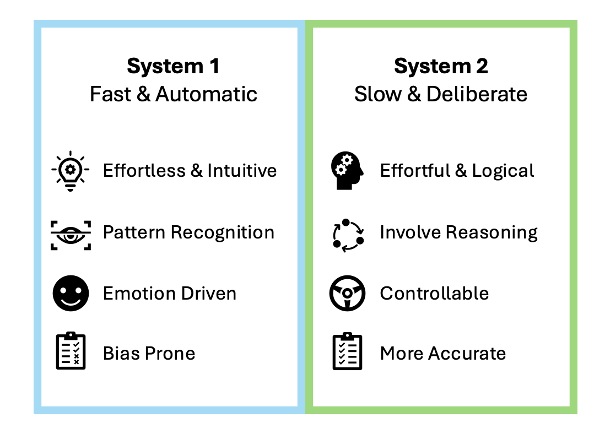
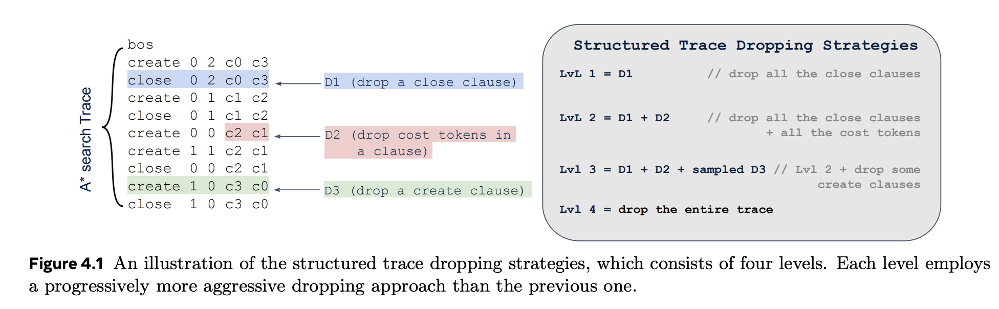
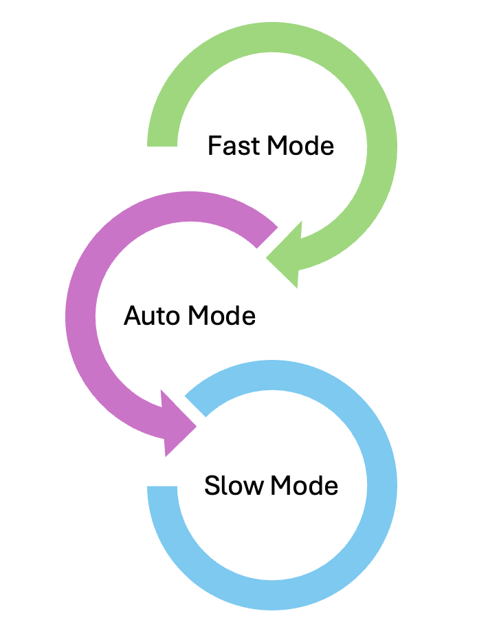
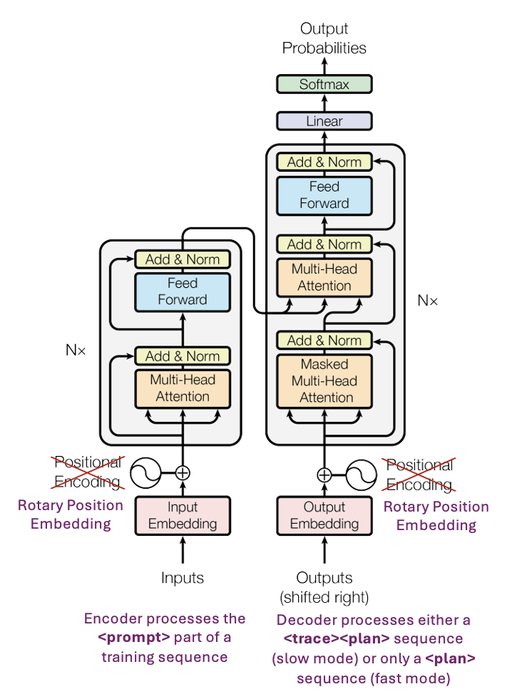

In this article, I talk about my understanding, personal impressions, and key takeaways on the *[“Dualformer: Controllable Fast and Slow Thinking by Learning with Randomized Reasoning Traces”](https://arxiv.org/pdf/2410.09918v1)* paper released by FAIR at Meta on October 15, 2024.

## Why is this paper interesting?

A lot of focus today in the space of Artificial Intelligence (AI) is about a single model that can think and reason at par with an average human being or better than an average human being. There is substantial curiosity and active research around how the large language models can think, reason, and act with the help of agentic frameworks. We will not get into that here. We will talk about ***thinking***. The process of thinking, the psychology of thinking, and the reproducibility of thinking. The last one is where this paper comes in.

So, let’s start!

## 1. The process and the psychology of thinking

A significant portion of civilization results from human thought. And if we were to understand the process of thinking, dual process theory is one of the key concepts. Explained in 1974 by Wason and Evans and popularized by Kahneman in 2017 (Thinking Fast and Slow), dual process theory proposes that human cognition operates through two distinct systems of thinking.

- **System 1:** fast, automatic and intuitive
- **System 2:** slow, deliberate and effortful

Essentially, System 1 relies on mental shortcuts easily at our disposal from memory to make quick opinions, judgements and decisions, and System 2 requires cognitive resources for systematic reasoning and analysis, and typically comes into play when called to make more careful evaluation.

And there is a beautiful play of information, speed, and accuracy that becomes essential to look at as we understand this dual process theory for thinking. We always have some information to make a decision, even if it is from memory or some kind of input at the moment. System 1 will use that information to make the decision fast, while System 2 may wait a little longer to collect more information if necessary.

Some decisions, like *choosing what to eat for breakfast*, might not require us to be so accurate as the risk of making that decision is generally low. In that case System 1 thinking is all that’s needed. But for higher risk decisions like *choosing an international graduate degree program or a family buying a first-time home*, the risk involved is much higher and the decision would require more thought, information, and analysis. Sometimes this **requires multiple trusted individuals using their System 2 thinking** to make decisions.

## 2. Ideas explored in the paper

Dualformer is a novel transformer-based architecture that integrates both fast and slow reasoning modes into a single model, inspired by this dual process theory. The model addresses a fundamental trade-off in AI reasoning systems: fast models are computationally efficient but less accurate, while slow models that generate detailed reasoning traces are more accurate but computationally expensive.

The core innovation lies in structured trace dropping during training. Instead of training separate models for fast and slow reasoning, Dualformer learns from ***randomized reasoning traces*** (think of this as a step by step process to complete a given task) where different parts are systematically dropped according to four hierarchical levels:

- **Level 1:** Drop "close" (successful completion of individual steps) clauses from *[A\* search](https://arxiv.org/pdf/2402.14083)* traces
- **Level 2:** Additionally drop cost information from remaining clauses
- **Level 3:** Further drop 30% of "create" clauses (creating/executing individual steps) randomly
- **Level 4:** Drop the entire reasoning trace, keeping only the final solution

Imagine training a new detective (say, an intern) by showing them case files with varying levels of detail. Here, "close" clauses indicate closed investigations, while "create" clauses indicate new ones.

- **Level 0:** The intern detective has all information available at once for a full methodical investigation
- **Level 1:** “Close” clauses are hidden, meaning the detective doesn’t know the investigations that are "closed" or the final outcome, but still has all active leads and knows the costs of pursuing these leads
- **Level 2:** Both “close” clauses and cost calculations are removed, meaning the detective doesn’t know the closed investigations, final outcome, or the cost of pursuing those investigations
- **Level 3:** Further, a random 30% of “create” clauses are dropped, meaning the detective doesn’t have information about 30% of the investigation cases
- **Level 4:** Drop entire reasoning trace, meaning the intern detective is given the final outcome of the case without any notes on the investigations and has to try trace back the details of all/necessary investigations to arrive at the final outcome

Learning in this systematic approach can teach the intern detective to solve cases efficiently when they are working on an active case in the future.

More about A\* algorithm can be understood from the [Searchformer](https://arxiv.org/pdf/2402.14083) paper released by Meta in April 2024. Very briefly, A\* is a pathfinding algorithm that finds the shortest route between two points, like navigating through a maze from start to goal.

- It works by maintaining two lists: a "create" list of locations it might explore next, and a "close" list of locations it has already checked.
  - For each potential location, A\* calculates two key values: the actual cost to reach that spot from the start, and a heuristic estimate of how far it still is from the goal (like manhattan distance in a grid). It combines these to prioritize which location to explore next, always choosing the most promising option.
- From the intern detective perspective, say there are 2 files – “active leads” (create list) of potential clues to investigate next and “case closed” (close list) of leads already thoroughly examined.
  - For each active lead, the intern detective should calculate both the effort already invested to reach that point and estimate the remaining work needed to solve the case, always pursuing the most promising lead first.

During training, each example randomly selects a dropping strategy from these levels, enabling the model to learn shortcuts in reasoning while maintaining the ability to generate full traces when needed. At inference time, Dualformer can operate in three modes:

- **Fast mode:** Outputs solutions directly without reasoning steps
- **Slow mode:** Generates complete reasoning traces plus solutions
- **Auto mode:** Automatically decides which approach to use

So, Dualformer is suggesting a unified system that can dynamically adjust its reasoning depth based on task requirements and user preferences. This mimics the human thinking process, where we unconsciously switch between intuitive quick decisions (System 1) and deliberate analytical thinking (System 2) depending on the situation's complexity and stakes.

The approach also addresses practical deployment concerns: a single model that can operate in multiple modes is more efficient than maintaining separate systems, while the structured dropping reduces training time by shortening input sequences.

## 3. Model Architecture

Most of the large generative models today use decoder-only framework. Dualformer uses encoder-decoder architecture, originally as explained in Attention is all you need [(Vaswani et al., 2017)](https://arxiv.org/pdf/1706.03762) and T5 architecture [(Raffel et al., 2020)](https://arxiv.org/pdf/1910.10683). A few changes include the rotary position encoding (RoPE) and the format of sequences. The **\<prompt\>** goes into the encoder along with the task specification. Decoder processes either a **\<trace\>\<plan\>** sequence (slow mode or search-augmented model) or only a **\<plan\>** sequence (fast mode or solution-only models).

The models are instantiated with T5 and RoPE for position encoding, and trained with 100K training samples. Model sizes are 15M and 46M for Maze and Sokoban tasks respectively.

For the fast mode, Dualformer is trained on sequence data that only includes the optimal final solution without a reasoning trace. The slow mode baseline is the Complete-Trace model trained on data with complete A\* search traces.

## 4. Experiments and Evidence

I really liked the experimental design. The authors are basically trying to answer the below key questions which align not only the thinking process, but also how one would want to use a large language model today for reasoning:

- Does Dualformer outperform corresponding baselines in fast, slow and auto mode? Does it generate more diverse plans?
- In slow model, does Dualformer lead to faster reasoning, i.e., output a shorter trace?
- Does the structured trace dropping technique generalize to LLMs trained on natural language datasets?

In terms of the evaluation process, whether a model generates correct or optimal plans is measured using two metrics: **1-Solved-64** and **1-Optimal-64**.

- 64 responses are randomly sampled from a trained model
- Each response is parsed and evaluated regardless of the generated trace part
  - 1-Solved-64: If any of the 64 plans is correct, i.e. plan is feasible and reaches the goal/finish, this task is labelled as success for the 1-Solved-64 metric
  - 1-Optimal-64:If any of the 64 plans is optimal, this task is labelled as success for the 1-Optimal-64 metric
- This is repeated for 1000 unseen evaluation tasks and report the average success rate
- To investigate the robustness of each method, metrics 3-Solved-64 and 3-Optimal-64, where a task is labelled as success if at least 3 plans are correct or optimal are also reported

The authors conducted experiments across pathfinding tasks and mathematical reasoning to validate Dualformer's effectiveness.

For pathfinding, they used maze navigation (15×15 to 30×30) and Sokoban puzzles with 100k training examples from A\* search traces. Results demonstrated substantial improvements:

- Fast Mode achieved 80% optimal solutions on 30×30 mazes versus 30% for solution-only baselines (2.67× improvement),
- Slow Mode reached 97.6% optimal rate using 45.5% fewer reasoning steps than complete-trace baselines, and
- Auto Mode delivered 96.6% optimal performance with 59.9% fewer steps than Searchformer and generated significantly more diverse valid solutions (18.23 vs 1.86 unique paths per task).

To answer the third question, “does the structured trace dropping technique generalize to LLMs trained on natural language datasets?”, the authors conducted mathematical reasoning experiments by fine-tuning Llama-3.1-8B and Mistral-7B models on the Aug-MATH dataset.

This Aug-MATH dataset creation is a nice experiment in itself. The dataset is derived from the MATH dataset (Hendrycks et al., 2021) that contains 7500 train and 5000 test examples of math questions and solutions. They take this data and use Llama-3.1-70B-Instruct model to rewrite the solutions with detailed intermediate steps. And then to introduce diversity, they sample 4 responses for each question. This produces an overall dataset of 30K training examples and 5K testing examples.

The evaluation shows consistent improvements from LLM finetuning, which proves that using this framework can be generalized. The key idea is that if one were to finetune this framework for a specific reasoning task, one can achieve much better performance compared to baseline.

## 5. Final Thoughts

Overall, Dualformer presents a compelling framework that bridges the gap between fast intuitive responses and deliberate reasoning by training models that can adapt to different thinking modes.

What makes this work particularly thought-provoking is its technical reproducibility of human-like cognitive processes, the ability to seamlessly switch between System 1 and System 2 thinking patterns, while simultaneously reducing computational overhead through intelligent sequence shortening and learning from randomized reasoning traces.

The authors' choice to explore encoder-decoder architectures alongside the dominant decoder-only paradigm demonstrates refreshing architectural diversity and suggests potential avenues for sophisticated reasoning capabilities that extend beyond current approaches. It will be fascinating to see if this line of research and experimentation can make small reasoning models perform better and more generalizable.

Kudos to all the authors and stakeholders who took this idea and produced quality studies with meaningful results. Not all ideas are pursued, those that do aren’t always successful. It is a hard process!
