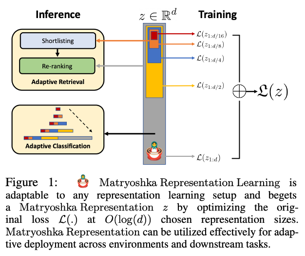
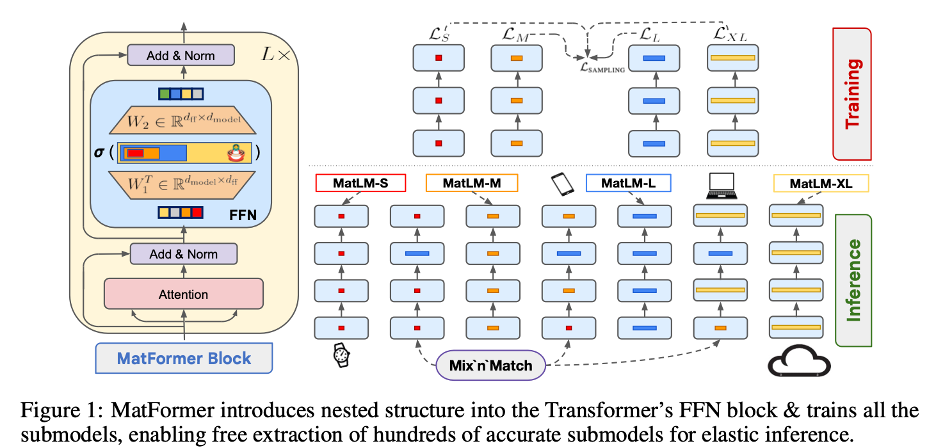
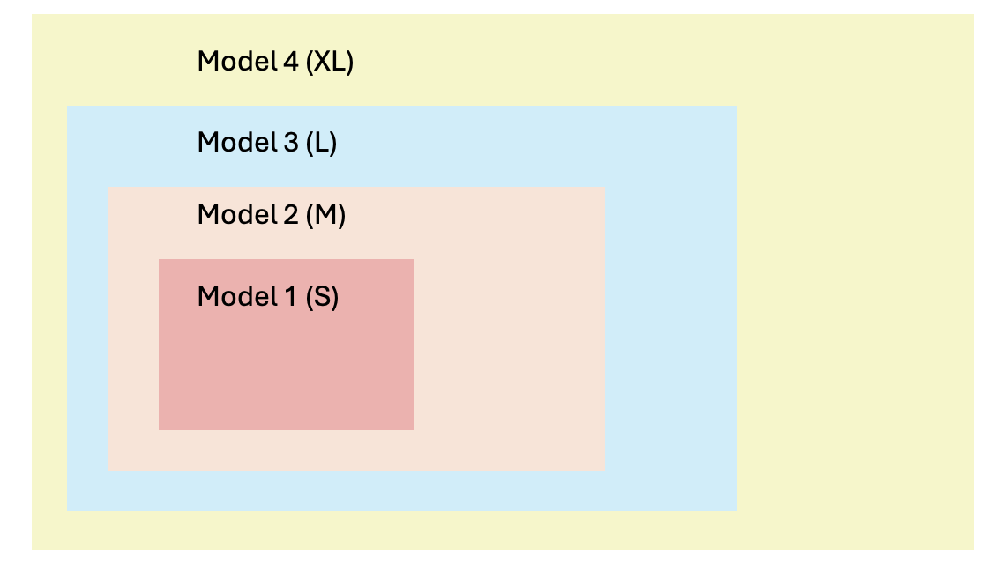

[MatFormer: Nested Transformer for Elastic Inference](https://arxiv.org/abs/2310.07707) published in December 2024, by Google DeepMind, is a novel Transformer architecture that enables training a single universal model from which hundreds of smaller, accurate submodels can be extracted without incurring additional training costs.

When I first came across the paper several months ago, I found myself returning to it repeatedly over the following weeks, carefully thinking about its implications. The publication has 10 pages of core content, 4 pages of references, and a 14-page appendix, showcasing the depth and rigor of the research. The paper is comprehensive and includes detailed experimental validation. Given this breadth and depth, a brief summary would fail to capture the work’s full significance.

Therefore, this article focuses primarily on the architectural contributions, though numerous other aspects deserve attention. In future work, I intend to examine their experimental methodology more closely and explore practical applications and derivative models, such as Gemma-3n.

## Primer: Foundational Concept

MatFormer infact follows its framework based on the principle of [Matryoshka Representation Learning (MRL)](https://arxiv.org/pdf/2205.13147), published in February 2024 by Google Research in collaboration with University of Washington and Harvard University.

The idea is MRL trains one big embedding vector (say, 2048 dimensions) but explicitly teaches the first 8 dimensions to be useful, then the first 16, then 32, and so on, all nested inside each other like those iconic matryoshka dolls. The magic happens during training: at each step, MRL randomly picks one of these nested sizes and computes the loss only for that subset, so the smallest dimensions get trained the most (they’re part of every larger size) and naturally become the most information-packed.

This means we can extract hundreds of different-sized models from one training run, if you’re running on a smartphone, just use the first 64 dimensions; if you’re in the cloud, use all 2048, without retraining anything or losing accuracy compared to models trained independently at each size.

**With that let’s take a look at the MatFormer architecture.**

There are 2 key components to the architecture.

- Nested sub-structure within the standard transformer block
- Simple heuristic framework called Mix’n’Match to finding submodels

This diagram from the paper captures the entire MatFormer story - architecture, training, and inference - all in one visual. The paper does a brilliant job explaining these mechanics concisely, covering the structure, training methodology, and inference process in just about 1.5 pages. But given how elegant and important this design is, I wanted to slow down and unpack it more carefully. That’s the goal of this article: to walk through those 1.5 pages in much greater detail, examining the pieces that make MatFormer work.

There are three interconnected components: MatFormer Block, Training Process, and Inference with Mix’n’Match. Each plays a distinct role, but together they form a cohesive system that enables elastic inference, the ability to extract hundreds of models from a single training run. Let’s break down each component step by step and see how they work together to achieve this remarkable flexibility.

## First: MatFormer Block (left side)

MatFormer block starts with the standard Attention layer (shown in pink) that processes input tokens, just like a regular Transformer. This remains largely unchanged from original architecture. After attention and normalization (Add & Norm shown in lavender), the input passes through the nested FFN block, where MatFormer's innovation happens.

The FFN contains two weight matrices:

- $W_1 \in \mathbb{R}^{d_{\text{model}} \times d_{\text{ff}}}$ projects the input to the hidden dimension

- $W_2 \in \mathbb{R}^{d_{\text{ff}} \times d_{\text{model}}}$ projects back to the model dimension

The diagram shows colored blocks (red, orange, blue, yellow) representing different neuron groups within these matrices. Each color corresponds to a granularity level:

- Red = Small (S) - uses first $m_1$ neurons
- Orange = Medium (M) - uses first $m_2$ neurons
- Blue = Large (L) - uses first $m_3$ neurons
- Yellow = Extra Large (XL) - uses all $d_{\text{ff}}$ neurons

The neurons are nested, meaning $S \subset M \subset L \subset XL$. The first neurons are very important because they're used by all submodels.

MatFormer defines $g$ Transformer blocks $T_i$, such that $T_1 \subset T_2 \subset \cdots \subset T_g$, where $T_i \subset T_{i+1}$ indicates that the parameters of $T_i$ are contained in those of $T_{i+1}$.

For a given granularity $i$, the FFN computes:

$$
T_i^{\text{FFN}}(x) = \sigma\left(x \cdot W_1[0{:}m_i]^\top\right) \cdot W_2[0{:}m_i]
$$

where $\sigma$ is the activation function (GELU), and $W_1[0{:}m_i]$ means use only the first $m_i$ rows of $W_1$.

So, think of weight matrices as a toolbox where tools are arranged by importance. MatLM-S uses only the 4 most essential tools (red), MatLM-M uses the top 8 (red + orange), and so on. All tools exist in one physical toolbox (single model), but different tasks use different subsets

## Second: Training Process (top right)

During each training step:

- One random granularity (S, M, L, or XL) with probability $p_i$ (uniform 25% each) is selected
- A batch is processed through only that granularity's neurons
- Loss is computed and the weights are updated

$$
\mathcal{L}_{\text{SAMPLING}}(x, y) = \mathcal{L}(M_i(x), y)
$$

where $\mathcal{L}_{\text{SAMPLING}}$ means picking from $\mathcal{L}_S$, $\mathcal{L}_M$, $\mathcal{L}_L$ and $\mathcal{L}_{XL}$

The diagram shows stacked layers for each granularity (S, M, L, XL columns). Each has 16 layers represented by horizontal boxes. During training, one granularity is active per step, but over many steps, all granularities get optimized. Meaning, all granularities train simultaneously!

And, when training XL, the shared parameters in S, M, and L also receive gradient updates. So MatLM-S effectively sees 4× more training data than independently trained models.

## Third: Inference with Mix'n'Match (bottom right)

After training, the Mix'n'Match process enables extracting hundreds of models by selecting different granularities at each layer.

The diagram shows example configurations:

- MatLM-S: All layers use S (red) granularity → 582M parameters
- MatLM-M: All layers use M (orange) → ~650M parameters
- MatLM-L: All layers use L (blue) → ~750M parameters
- MatLM-XL: All layers use XL (yellow) → 850M parameters

But can also create hybrid models like:

- Layers 1-8: M granularity, Layers 9-16: L granularity
- Layers 1-4: S granularity, Layers 5-12: M granularity, Layers 13-16: L granularity

Therefore, with 4 granularities and 16 layers, this yields 4^16 possible configurations.

This achieves performance comparable to Neural Architecture Search (NAS) without the computational overhead. The icons in the diagram show deployment scenarios:

- Smartphone (MatLM-L): Mid-size model for mobile devices
- Laptop (MatLM-M): Medium model for on-device processing
- Cloud (MatLM-XL): Full model for server-side inference

All extracted from the same universal model without additional training.

**To summarize:**

- Because the neurons are ordered by significance, $m_1 < m_2 < m_3 < m_g$, extracting the first $m_i$ neurons produces coherent models. The training process learns this ordering by optimizing nested subsets simultaneously. Therefore, training involves,
  - Input → Attention → Add & Norm
  - → Sample granularity (S/ M/ L/ XL)
  - → Use corresponding neurons in FFN
  - → Add & Norm → Output
  - → Compute loss for sampled granularity
  - → Repeat with different random granularity
- Achieves elastic inference, one training run produces a continuum of models spanning 582M to 850M parameters, each optimized for different deployment constraints. Therefore, inference involves,
  - Selecting target parameter budget (e.g., 700M params)
  - Using Mix'n'Match heuristic to gradually increase granularity across layers
  - Extracting specific submodel (e.g., layers 1-10 use M, layers 11-16 use L)
  - Deploying extracted model with zero additional training cost

Finally, I want to explore a **critical design decision** the authors make. While MatFormer’s nested structure could theoretically be applied to any Transformer component, the authors deliberately chose to focus on the FFN block. The authors explicitly acknowledge that nested structure could be imposed on any part of the Transformer, and they even provide experiments applying MatFormer to attention blocks in Appendix F2. However, they focus their primary approach on the FFN block because “the model size and computational cost of a Transformer is dominated (around 60% for LLMs and ViTs) by the FFN block”. This strategic focus on the largest parameter contributor makes MatFormer both practical and powerful.

**Brief technical explanation on this key decision:**

Feed-Forward Network (FFN) block dominates the transformer models because it contains approximately twice as many parameters as the multi-head attention mechanism in each layer. This is an approximation we can make with the original transformer block design.

The attention mechanism uses four projection matrices ($W_q$, $W_k$, $W_v$, $W_o$) totaling

$$
P_{\text{attention}} \approx 4\, d_{\text{model}}^2 \text{ parameters}
$$

because each $W$ has $d_{\text{model}}^2 + d_{\text{model}} \approx d_{\text{model}}^2$ parameters. In BERT this is $768^2 + 768 \approx 768^2$ parameters.

The FFN employs two linear layers with an intermediate expansion giving,

$$
P_{\text{FFN}} = 2 \times d_{\text{model}} \times d_{\text{ff}} \approx 8\, d_{\text{model}}^2 \text{ parameters}
$$

because typically $d_{\text{ff}} \approx 4\, d_{\text{model}}$. In BERT, $d_{\text{model}} = 768$ and $d_{\text{ff}} = 3072$.

This 2:1 ratio means FFN accounts for roughly 66% of parameters within transformer layers, and when considering embeddings and other components, FFN still constitutes approximately 52-60% of the entire model's parameters across standard architectures like BERT, GPT, and Vision Transformers. MatFormer exploits this dominance by introducing nested structure exclusively in the FFN block, enabling elastic inference where hundreds of accurate submodels can be extracted without additional training. Also, by keeping everything else same this creates a strong hypothesis to test.

## Closing Thoughts

With that, I’ll bring this deep dive to a close. Sometimes the most rewarding part of research is simply sitting with the mathematics and architectural elegance, letting novel ideas settle, connecting them to applied science, and imagining how they might reshape the applications we build.

At a time when the research world is moving too fast, when papers rush to publication without adequate evaluation or mathematical rigor, MatFormer is a reminder of what thoughtful work looks like. The detailed analysis, deliberate design, and thorough investigation here are refreshing. As someone focused on applied machine learning, encountering research of this caliber is genuinely inspiring. It’s the kind of excellence that drew me to this field and makes this field worth pursuing.
