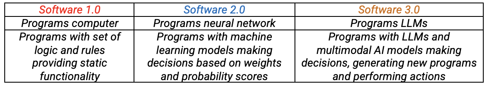
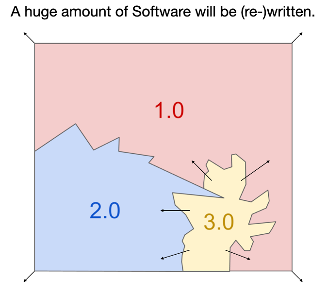
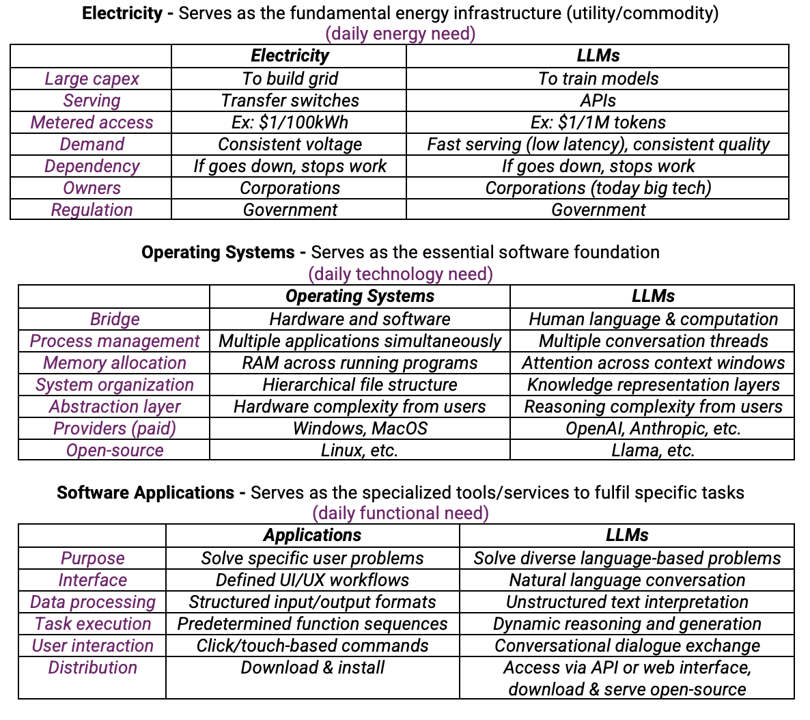
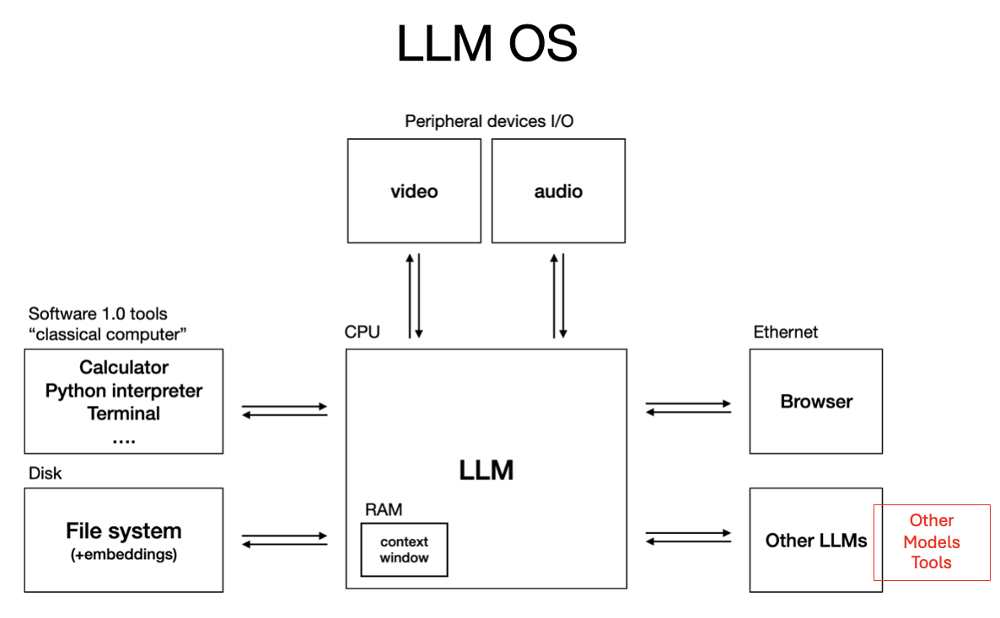
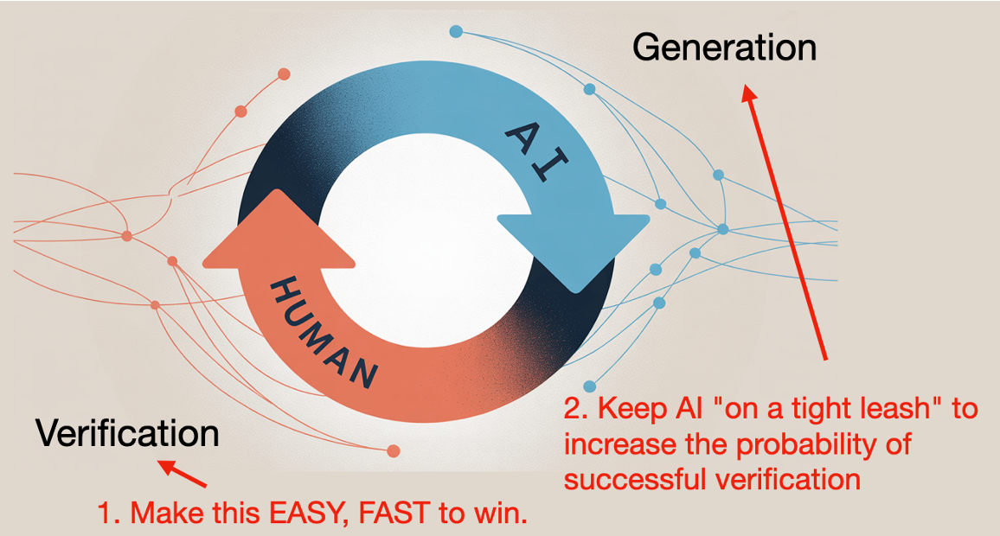

When the former Tesla AI director and OpenAI researcher takes the stage to discuss software's evolution, the tech world listens. Andrej Karpathy's recent keynote, [**Software Is Changing (Again)**](https://www.youtube.com/watch?v=LCEmiRjPEtQ&t=138s), at AI Startup School offers a compelling thesis: software development is undergoing another fundamental transformation.

In this article, I provide an overview of the keynote, along with my understanding and perspectives.

Andrej starts his keynote by discussing how software is changing. He says, "Software hasn't changed for 70 years, and then it changed quite rapidly in the last few years."

Here’s my understanding of the differences between Software 1.0, 2.0, and 3.0:

- All software should have a purpose, or specific tasks that meet user requirements.
- In software 1.0, this purpose was met through a set of hardcoded programs/codes based on a thorough understanding of and design for every actionable space.
- With seminal works and the adaptation of backpropagation (~1986) and machine learning algorithms, the same purpose was met using a combination of the rules from Software 1.0 and new models that made decisions based on weights and probability scores in Software 2.0.
- Software 3.0 presents another pivotal shift happening much faster than previous transitions. Breakthroughs in innovation have led to transfer learning (Imagenet/Alex Net, ~2009), attention mechanisms, and transformer-based frameworks (2017), and large-scale foundational models (2022+), including language models, multimodal models, and reasoning models. Software 3.0 will combine the best of Software 1.0's rules, Software 2.0's deterministic models, and newer, larger models (like LLMs).

## Why is this relevant?

Because we are at a point in time, where this change in the software paradigm is going to empower us to solve more complex problems and give us tools to solve them faster. As a result, this will also change the way we program and build systems!

In doing this, “software 3.0 will only grow and will expand and replace a lot of software 1.0 and 2.0” seems like the direction ahead.

## Analogies

The keynote draws three compelling analogies to explain how LLMs are similar to existing utilities, systems, and applications. The **electricity analogy** positions LLMs as a fundamental utility requiring massive capital investment to build infrastructure (training models vs. power grids), delivered through metered access points (APIs vs. transfer switches), and creating critical dependencies where outages halt productivity. The **operating system analogy** frames LLMs as essential software foundations that bridge human language with computation, manage multiple simultaneous processes (conversation threads vs. applications), and provide abstraction layers that hide underlying complexity from users. Finally, the **software application analogy** views LLMs as specialized tools that solve problems through natural language interfaces rather than traditional UI workflows, processing unstructured text input and enabling dynamic reasoning instead of predetermined function sequences.

Here is my compilation and comparison on the three analogies.

I found the discussion on how LLMs could be a new paradigm in the evolving technology ecosystem interesting and believe it deserves more discussion. If we accept the idea that "AI is the new electricity" (Andrew Ng), then we must understand the adoption, distribution, and regulation of such a seminal innovation, it's impact on existing industries, knowledge workers and users, along with its limitations and pitfalls.

Andrej goes on to share a LLM technology stack in the talk, which I found to be a potential future operating system. The addition I would add to this is in red. In my understanding, it doesn’t have to be LLMs for everything. Sometimes small language/vision models can do a task as well as or even better than LLMs with lesser compute, hallucination, and security risk. The design of the system could be to use different models and decision frameworks along with LLMs as part of the entire decision making space.

He reiterated his tweet, "English is the new programming paradigm," which is based on programming prompts in LLMs for Software 3.0. While I don't think this statement is incorrect, I also don't believe this concept is entirely new. If we recall our introduction to Structured Query Language (SQL) or Python classes, we might remember our professors or tutors saying, "Query a database using these English words as syntax" (e.g., "Select columns from table with table value less than 100"). Following this same pattern, programming has become easier by using not just databases, but also decision-making models (Ex. Given this product pricing and revenue data, what insights can you draw about the product?). In my opinion, "ease" is a better way to describe this concept than "new," and programming follows a similar paradigm to other technologies in that it improves and becomes easier over time.

## What’s next on the keynote?

Personal computing has evolved from centralized, expensive machines in the 1960s to today's powerful laptops. Although large language models (LLMs) require substantial computational resources, advancements in model distillation, scaling laws, quantization, fast inference frameworks, and hardware innovations (e.g., NVIDIA Spark and Apple Max Studio) are making sophisticated personal computing more accessible.

As a result, using LLMs is now easier for more people than using early technologies like electricity or operating systems, which were initially available only to large corporations and governments. As early-stage users, we experience both the benefits and drawbacks of LLMs without comprehensive and standard quality control measures and regulations in place. In his talk, Andrej Karpathy touches on why today's LLMs are not perfect: hallucinations, jagged intelligence (e.g., 9.11 \> 9.99, two "r"s in "strawberry"), memory constraints (e.g., no continual learning or sleep to consolidate knowledge, like in humans).

But in all sincerity, nothing new has ever been built perfectly, and AI is no different! I'm thinking out loud here, probably the next pretraining objective would be to let LLMs start simulating dreams (generating new/alternative patterns of data) and learning from them.

The rest of the talk is about how to use these models and the opportunities they present. It was catered to students entering graduate school to encourage early adoption and accelerate learning by focusing on solving problems. Here are a few interesting points from the rest of the talk:

- Don't spend 5-10 years mastering software engineering to build applications
- Coding is only part of the solution
- Orchestration, security, authentication, data management, deployment, monitoring, etc., are all integral to the solution

Combining these elements leads to the development of agentic systems.

## My Thoughts & Conclusion

I really liked this talk, which addressed the pivotal technological moment we are all experiencing today.

Software, application design, and implementation are changing fundamentally—probably for the better, with greater efficiency, impact, and productivity. There's no denying that. As a student and practitioner of technology, I believe that using LLMs can accelerate code writing and problem solving. The concept of vibe coding also makes sense when you're a developer trying to build a quick prototype with a basic understanding of the data, problem, and solution landscape.

That said, since this talk was geared towards students entering graduate school I want to add a few personal impressions and thoughts. There is a lot of emphasis on using AI tools to accelerate learning and programming. In several platforms there are discussions about AI replacing programmers in the workplace.

While I certainly believe that AI will augment and even replace certain functions, I’d also like to emphasize my belief that learning the fundamentals of coding is still valuable for students of technology. Having strong foundational skills in at least one programming language and an understanding of different data structures and algorithms can help developers adapt to a changing landscape with ease. In my opinion, coding is more than just a program written in a specific language. It combines the critical thinking and problem-solving processes. I agree that one doesn't need to memorize syntax anymore. LLMs excel in that area!

In my opinion, as developers, we might no longer be coding to perform the tasks that LLMs can perform very well without the need for any supervision. However, we will need to program systems and complex solutions that use will LLMs and other AI systems, and orchestrate them intelligently alongside other appropriate tools and deterministic decision making modules. The goal is still to **solve problems by designing and building systems that fulfill functionality, set of tasks, and user requirements, in a helpful and secure way**. This, along with what Andrej Karpathy says in the slide below, "keep AI on leash" and "software will be partially autonomous," is a direction to developers on the changing nature of the job.

Overall, Andrej Karpathy gave a fantastic talk to students. The keynote offers valuable insights for developers across all experience levels, from students to seasoned experts. I found listening to it as an excellent thought exercise and is well worth watching for anyone interested in the field!
